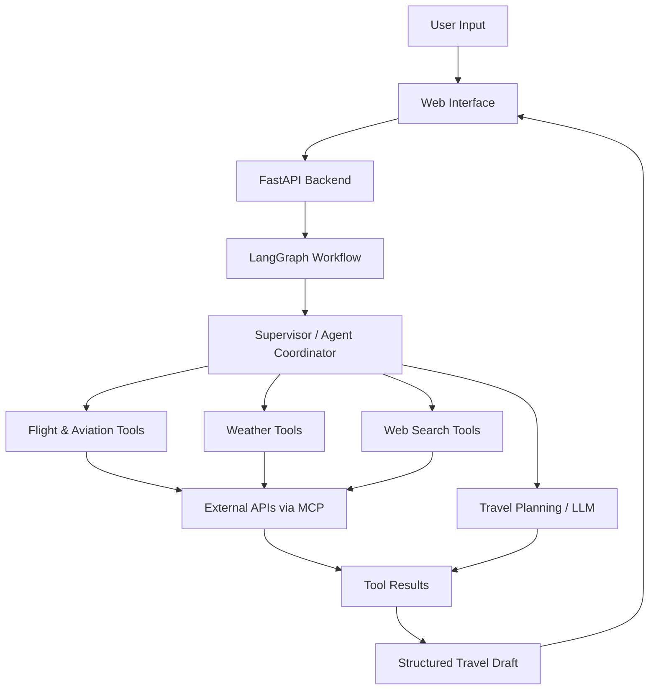

 <div align="center">


# ✈️ TripMate AI

### An Intelligent Multi-Agent Travel Planning System

**From travel ideas to structured itineraries — powered by AI agents, tool integrations, and workflow orchestration.**

<p>
  
  
  
  
  
</p>

<p>
  <a href="#-overview">Overview</a> •
  <a href="#-key-features">Features</a> •
  <a href="#-system-architecture">Architecture</a> •
  <a href="#-tech-stack">Tech Stack</a> •
  <a href="#-installation--setup">Installation</a> •
  <a href="#-configuration">Configuration</a>
</p>

</div>

---

## 🌍 Overview

**TripMate AI** is an AI-powered travel planning application designed to turn user preferences into organized, personalized travel drafts.

Instead of relying on a single LLM call, the project uses a multi-agent workflow to coordinate travel-planning tasks, interact with external tools, and assemble the results into a structured itinerary.

The application combines a FastAPI backend, LangGraph-based agent orchestration, MCP tool integrations, and a web interface to explore an agent-driven travel planning workflow.

### 🎯 Project Goal

Build a practical AI application that demonstrates how multiple specialized agents and external tools can work together to solve a real-world planning problem.

## ✨ Key Features

| Feature | Description |
|---|---|
| 🧠 Multi-Agent Orchestration | Coordinate travel-planning tasks through an agent workflow. |
| 🗺️ AI Itinerary Generation | Generate structured, day-by-day travel plans based on user preferences. |
| ✈️ Aviation Integration | Connect aviation-related tools for airport, airline, and flight information where supported. |
| 🌦️ Weather Integration | Retrieve destination weather information through a weather service. |
| 🔎 Web Search | Integrate search tools to gather relevant travel information. |
| 🛡️ Guardrails | Support controlled agent execution and safer workflows where configured. |
| 🙋 Human-in-the-Loop | Support approval-based workflows where implemented. |
| ⚡ FastAPI Backend | Expose application functionality through API endpoints. |
| 🖥️ Web Interface | Interact with the travel planner through a browser-based frontend. |

> **Data accuracy:** Generated recommendations are not automatically verified live data. Flight availability, fares, hotel prices, and schedules depend on the connected providers, API permissions, and successful tool responses.

## 🏗️ System Architecture

The application follows an agent-oriented architecture in which the user request is processed by the backend and routed through the travel-planning workflow.



### 🔄 How It Works

1. **User Request:** The user provides travel preferences, destination, dates, or other trip requirements.
2. **Backend Processing:** FastAPI receives the request and passes it into the application workflow.
3. **Agent Orchestration:** LangGraph coordinates the configured agents and workflow steps.
4. **Tool Execution:** Agents call available tools for relevant travel, aviation, weather, or search information.
5. **Result Assembly:** The application combines available results with LLM-generated recommendations.
6. **Travel Draft:** The frontend displays the generated itinerary.

*Architecture diagram represents the intended high-level workflow; exact routing and agent responsibilities depend on the implementation.*

## 🧰 Tech Stack

| Category | Technology |
|---|---|
| Programming Language | Python |
| Backend Framework | FastAPI |
| Agent Orchestration | LangGraph |
| LLM Framework / Integrations | LangChain, where configured |
| Model Provider | Groq API |
| Tool Integration | Model Context Protocol (MCP) |
| Aviation Data | AviationStack API |
| Search | Tavily API |
| Weather | OpenWeather API |
| Monitoring / Tracing | LangSmith, if configured |
| Frontend | HTML, CSS, JavaScript |
| Configuration | Environment variables using `.env` |

## 📂 Project Structure

```text
TripMate-AI/
│
├── app.py
├── backend.py
├── mcp_client.py
├── custom_weather_mcp_server.py
│
├── templates/
│   └── index.html
│
├── static/
│   ├── css/
│   ├── js/
│   └── ...
│
├── requirements.txt
├── .env                  # Local secrets; never commit
├── .gitignore
├── Dockerfile
└── README.md
```

*The tree is illustrative. Actual filenames and folders may differ depending on the current repository version.*

## ⚙️ Installation & Setup

### Prerequisites

Install the following before running the project:

- Python installed and available in PATH
- Visual Studio Code
- Git (optional)
- API credentials for the services you want to use

### 1. Clone the Repository

If your project is hosted on GitHub:

```bash
git clone <YOUR_REPOSITORY_URL>
cd <YOUR_PROJECT_FOLDER>
```

Alternatively, open your existing project folder in VS Code.

### 2. Create a Virtual Environment

**Windows — PowerShell**

```powershell
python -m venv .venv
```

Activate the environment:

```powershell
.\.venv\Scripts\Activate.ps1
```

If PowerShell blocks activation, run the following in the current terminal session:

```powershell
Set-ExecutionPolicy -Scope Process -ExecutionPolicy Bypass
```

Then activate the environment again.

### 3. Install Dependencies

```powershell
python -m pip install --upgrade pip
python -m pip install -r requirements.txt
```

Wait for installation to finish before starting the application.

### 4. Configure Environment Variables

Create or update a `.env` file in the project root.

```dotenv
GROQ_API_KEY=your_groq_api_key
AVIATION_STACK_API_KEY=your_aviationstack_api_key
TAVILY_API_KEY=your_tavily_api_key
OPENWEATHER_API_KEY=your_openweather_api_key
DATABASE_URL=your_database_url
```

Add other variables required by your implementation, including tracing credentials if applicable.

**Never commit real API keys or database credentials to GitHub.**

### 5. Start the Application

From the project root, run:

```powershell
python -m uvicorn app:app --reload
```

When the server starts successfully, open:

**http://127.0.0.1:8000**

Keep the terminal running while using the application.

To stop the server, press `Ctrl + C`.

## 🔑 Configuration & External Services

| Service | Purpose | Documentation |
|---|---|---|
| Groq | LLM inference | [Groq Console](https://console.groq.com/) |
| AviationStack | Aviation-related information | [AviationStack](https://aviationstack.com/documentation) |
| Tavily | Search integration | [Tavily](https://docs.tavily.com/) |
| OpenWeather | Weather information | [OpenWeather](https://openweathermap.org/api) |
| LangSmith | Workflow tracing and debugging | [LangSmith](https://docs.smith.langchain.com/) |

The application can only access the API functions and data permitted by each provider's subscription and configuration.

## 🧪 Troubleshooting

<details>
<summary><strong>Application fails to start</strong></summary>

Check that your virtual environment is active and the dependencies have been installed.

```powershell
python -m pip install -r requirements.txt
python -m uvicorn app:app --reload
```

</details>

<details>
<summary><strong>Missing API key</strong></summary>

Confirm that `.env` exists in the expected location, the variable names match the code, and the application loads the environment variables correctly.

Restart the application after updating configuration.

</details>

<details>
<summary><strong>AviationStack function_access_restricted</strong></summary>

This error indicates that the requested API function is not available under the current subscription or permissions.

Check your provider's endpoint access. Add error handling or a fallback so an unavailable aviation function does not unnecessarily block other travel-planning tasks.

</details>

<details>
<summary><strong>Frontend loads but itinerary generation fails</strong></summary>

Inspect the VS Code terminal for backend errors, tool-call failures, model errors, and API responses. A successful homepage load does not prove that every agent and external service is working.

</details>

## 🚀 Future Improvements

Potential directions for further development include:

- [ ] More robust API failure handling and fallbacks
- [ ] Better validation of flight and hotel information
- [ ] Source attribution for externally retrieved information
- [ ] Persistent trip history and user preferences
- [ ] Improved itinerary editing and regeneration
- [ ] Automated tests for agents and API integrations
- [ ] Deployment with secure environment configuration
- [ ] More detailed agent tracing and evaluation

These are proposed improvements, not claims that every feature is already implemented.

## 🔒 Security

- Store API credentials in environment variables.
- Keep `.env` excluded from version control.
- Avoid logging secrets or sensitive user information.
- Validate user inputs and external API responses.
- Apply approval checks to sensitive actions where required.

## 👨‍💻 About the Developer

**Afzal Manihar**

I am focused on building practical applications with Generative AI, Agentic AI, LLMs, and multi-agent workflows. TripMate AI is a hands-on project exploring how agent orchestration and external tools can be combined into a useful travel-planning experience.

- 🌐 **Portfolio:** [afzalmanihar.github.io](https://afzalmanihar.github.io)
- 💻 **GitHub:** [@AfzalManihar](https://github.com/AfzalManihar)
- 🔗 **LinkedIn:** [Connect with me](https://www.linkedin.com/in/afzal-manihar-bb0183308/)

## 🙏 Acknowledgements

Thanks to the open-source communities behind FastAPI, LangGraph, LangChain, and MCP for the tools and documentation that support experimentation with agentic applications.

## 📄 License

Add the appropriate license file to the repository before describing the project as open source under a particular license.

---

<div align="center">

**Built with Python, LLMs, and an agent-first approach.** ✈️

*Explore. Plan. Discover.*

</div>
